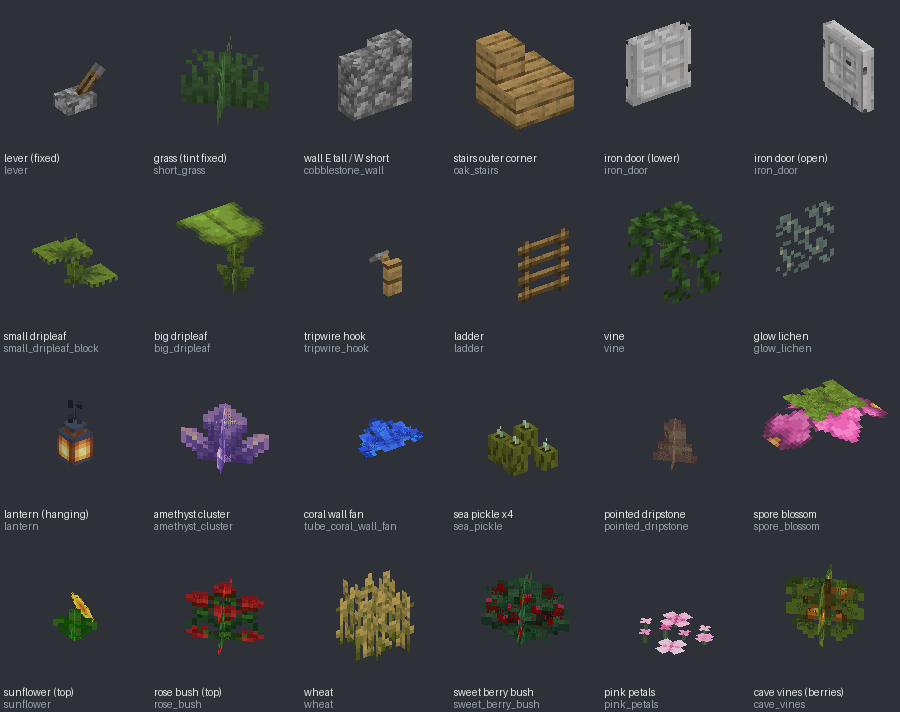

# 디버그 스틱 (독립형 블록)

`dist/DebugStick.mcaddon` — 행동 팩 + 리소스 팩. MCBE **1.26.40 이상**.

vytdev의 [Debug Stick](https://github.com/vytdev/debug-stick)(MIT)에 **독립형 블록**을 더한 버전입니다.
바닐라 블록을 디버그 스틱으로 치면 모양이 똑같은 `vyt:ds_<바닐라이름>` 블록으로 바뀌고,
그 뒤로는 이웃 블록이나 받침이 바뀌어도 모양이 그대로 남습니다.



## 조작

| 동작 | 결과 |
|---|---|
| 탭 | 선택한 상태값 변경 (바닐라 블록은 첫 탭에서 독립형으로 변환) |
| 길게 누르기 | 편집할 상태 선택 |
| 웅크리기 + 탭 | 블록 정보 |
| 웅크리기 + 길게 누르기 | 바닐라로 되돌리기 |
| 블록 선택(픽 블록) 버튼 | 기존 독립형 블록은 **보고 있는 상태 그대로** 아이템이 됨 |

## 이번 버전에서 고친 것

- **동/서가 뒤바뀌어 있던 문제.** Bedrock 블록 모델 파일은 X축이 뒤집혀 있습니다(동쪽이 −X).
  이전 모델은 반대로 만들어져 있어서 한쪽만 연결된 울타리·담장·유리판·철창, 계단, 레버, 횃불, 버튼이
  좌우가 바뀌어 보였습니다. 모델과 충돌 상자를 모두 다시 만들었습니다.
- **레버가 깨져 보이던 문제.** 받침까지 레버 손잡이 텍스처(거의 투명)로 그려서 받침 대신 가는 조각만 보였습니다.
  받침은 조약돌, 손잡이는 레버 텍스처로 다시 만들었고, 손으로 누르면 켜지고 꺼지며 켜졌을 때 레드스톤 신호(15)를 냅니다.
  버튼도 누르면 들어갔다가 1초(나무는 1.5초) 뒤에 올라오며 그동안 신호를 냅니다.
- **잔디가 어둡고 바닐라와 다르던 문제.** 잔디·고사리·덤불 텍스처는 원래 회색이라 바이옴 색을 입혀야 하는데
  그게 빠져 있었고, 면 방향별 음영까지 들어가 있었습니다. 바이옴 색(`tint_method`)을 넣고 음영을 뺐습니다.
  덩굴은 나뭇잎 색, 낙엽은 마른 잎 색, 수련잎은 고정 색입니다.
- **담장 높이.** 각 면이 `0 없음 / 1 낮음 / 2 높음` 세 단계이고, 가운데 기둥(`vyt:post`)은 따로 켜고 끕니다.
  변환할 때 바닐라 담장의 실제 상태(`wall_connection_type_*`, `wall_post_bit`)를 그대로 읽습니다.
  충돌 높이도 바닐라처럼 1.5블록(울타리 포함)입니다.
- **계단 충돌.** 꽉 찬 블록이 아니라 바닐라처럼 계단 모양이라 걸어서 올라갈 수 있습니다.
- **변환 정확도.** 최신 버전에서 바닐라가 상태로 내주는 울타리 연결(`minecraft:connection_*`),
  계단 모서리(`minecraft:corner`)를 읽어서, 변환해도 모양이 그대로입니다.
- 불에 타는지 여부, 단단함(캐는 시간), 소리가 바닐라 블록과 같습니다.

## 추가한 블록 (104종 + 철문)

받침이 없으면 떨어지는 블록을 모두 추가했습니다. 바닐라 블록을 치면 변환되고, `/give @s vyt:ds_<이름>`으로도 얻을 수 있습니다
(전체 목록은 행동 팩의 `BLOCK_IDS.txt`).

- 벽·천장: 사다리, 철사 덫 갈고리, 덩굴, 발광 이끼, 스컬크 정맥, 수지 덩어리, 랜턴/영혼 랜턴/구리 랜턴 8종(매달림 포함),
  자수정 송이·싹 4종, 선반 버섯, 벽 산호 부채 10종
- 바닥 식물: 진홍·뒤틀린 균, 진달래·꽃 핀 진달래, 포자 꽃, 창백한 매달린 이끼, 맹그로브 번식체, 뾰족한 점적석, 유황 가시,
  바다 피클, 수련잎, 사탕수수, 달콤한 열매 덤불, 네더 사마귀, 밀·당근·감자·비트·횃불꽃 작물, 분홍 꽃잎, 들꽃, 낙엽,
  큰 흘림잎, 뒤틀린·우는 덩굴, 동굴 덩굴(열매 포함), 포플러 묘목, 이끼·창백한 이끼 카펫, 카펫 16색, 산호 10종, 산호 부채 10종
- 두 칸짜리: 해바라기, 라일락, 장미 덤불, 모란, 큰 잔디, 큰 고사리, 벌레잡이풀, 작은 흘림잎
  — 놓으면 위아래가 같이 놓이고, 한쪽을 부수면 같이 부서집니다.

상태 이름은 바닐라 상태 이름에 `vyt:`를 붙인 것입니다(예: `vyt:hanging`, `vyt:growth`).
여섯 방향에 붙는 블록(발광 이끼 등)은 `vyt:north`·`vyt:up`처럼 면마다 켜고 끕니다.
덩굴류는 `vyt:body`(0 끝, 1 줄기)로 끝 모양과 줄기 모양을 고릅니다.

**픽 블록으로 상태 유지는 기존 블록(위의 "고친 것" 목록에 해당하는 229종)에만 적용**되고, 새로 추가한 블록에는 적용하지 않았습니다.

## 독립형 철문 (`vyt:ds_iron_door`)

바닐라 철문은 텍스처의 얇은 불투명 부분이 먼 거리용 저해상도(밉맵)에서 투명 처리돼 일정 거리 밖에서 사라집니다.
이 철문은 같은 모델·텍스처를 `alpha_test_to_opaque`로 그려서, 가까이서는 똑같이 보이고 렌더 거리 절반 밖에서는
불투명하게 그려져 사라지지 않습니다.

- 두 칸, 놓는 사람이 보는 방향으로 놓임, 왼쪽에 같은 방향 철문이 있으면 경첩이 반대로(양문)
- 레드스톤 신호를 받으면 열리고(위·아래 어느 쪽이든), 끊기면 닫힘. 여닫는 소리 포함. 손으로는 안 열림(바닐라와 같음)
- 바닐라 철문을 디버그 스틱으로 치면 위아래 모두 변환됩니다.

## 알아둘 점

- 사다리·덩굴은 모양만 같고 **오를 수는 없습니다**(커스텀 블록에는 오르기 기능이 없음).
- 압력판은 모양만 고정하며 밟아도 신호를 내지 않습니다.
- 먼 거리 불투명 처리는 철문에만 적용했습니다. 식물에 쓰면 투명한 부분이 멀리서 색 덩어리로 보이기 때문입니다.
- 대나무, 켈프, 해초, 코코아, 수박·호박 줄기, 레일·레드스톤 가루는 넣지 않았습니다
  (바닐라와 같은 텍스처 배치를 확보할 수 없거나, 블록 고유 기능 없이는 의미가 없음).
- 픽 블록: 같은 블록 아이템이 이미 핫바에 있으면 게임이 그 칸으로 이동만 하므로, 그 아이템이 상태를 안 가진 경우에만 새로 상태를 기록합니다.
  이미 다른 상태가 기록된 아이템은 버리고 다시 집으세요.

## 다시 만들기 (개발자용)

블록 파일·모델·이름·스크립트 표는 `tools/debug_stick`이 만듭니다. 손으로 고치지 마세요.

```
python3 -m debug_stick.build   --ref <참조 데이터>   # tools/ 에서 실행
python3 -m debug_stick.package                      # dist/DebugStick.mcaddon
```

참조 데이터(저장소에 넣지 않음):
`<ref>/bs` = Mojang/bedrock-samples(1.26.50), `<ref>/java` = Java 26.3 assets, `<ref>/mcd` = PrismarineJS/minecraft-data,
`<ref>/mcm` = misode/mcmeta 26.2-summary. Java↔Bedrock 상태 표는 GeyserMC/mappings(MIT)에서 뽑아
`tools/debug_stick/data/geyser_states.json`에 넣어 두었습니다.

검사:

| 명령 | 확인 내용 |
|---|---|
| `debug_stick.schema_check <bs>/metadata/json_schemas` | 블록 파일이 Mojang 공식 스키마를 통과하는지, 상태값 16개 제한 |
| `debug_stick.refcheck <bs>/resource_pack` | 텍스처 파일·모델·뼈대·재질·충돌 범위·이름이 모두 존재하는지 |
| `debug_stick.verify --ref <ref>` | 4431개 상태를 Java 모델과 생성된 모델로 각각 렌더링해 모양 비교 |
| `debug_stick.jscheck --ref <ref>` | 실제 변환 스크립트로 바닐라 상태 5011개를 변환·복원해 모양이 같은지 |
