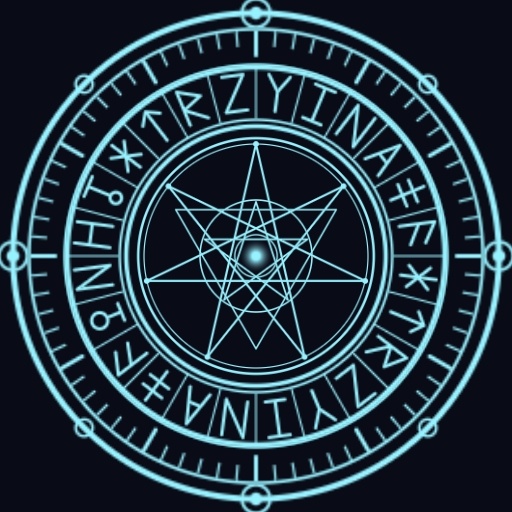

# 마법진 커스텀 파티클 (Bedrock)

바닥에 그려지고 회전하는 **마법진 파티클 세트**입니다. 텍스처까지 전부 이 저장소에서
생성되며, 외부 에셋을 쓰지 않습니다.



*3겹 레이어를 실제 게임 크기 비율 그대로 합성한 이미지 (지름 약 5.2블록)*

---

## 1. 설치

| 파일 | 내용 |
|---|---|
| `dist/MagicCircle.mcaddon` | **권장.** 리소스팩(파티클) + 비헤이비어팩(소환 함수) 한 번에 |
| `dist/MagicCircleParticles.mcpack` | 파티클만 필요할 때 (리소스팩 단독) |

1. 파일을 실행하면 마인크래프트가 자동으로 가져옵니다
2. 월드 설정 → **리소스 팩**에서 `마법진 파티클` 적용
3. `.mcaddon`을 썼다면 **비헤이비어 팩**에서 `마법진 소환 함수`도 함께 적용
4. 월드에 들어가 아래 명령어를 실행합니다

> 파티클은 리소스팩이 로드될 때 읽힙니다. 팩을 적용한 뒤에는 **월드를 나갔다 다시 들어가세요.**

---

## 2. 사용법

### 함수로 한 번에 (비헤이비어팩 필요)

```
/function magic/cast      전체 연출 (충격파 + 폭발 + 마법진 + 빛기둥)
/function magic/circle    마법진 3겹 + 상승 입자만
/function magic/burst     발동 순간 연출만 (약 1초)
```

명령어를 실행한 **위치 기준**으로 생성됩니다. 다른 곳에 띄우려면:

```
/execute as @p at @s run function magic/cast
/execute positioned 100 64 -30 run function magic/cast
```

### 파티클 하나씩 직접 (리소스팩만으로 가능)

```
/particle magic:circle_outer ~ ~ ~
```

| 식별자 | 역할 | 지속 | 지름/크기 |
|---|---|---|---|
| `magic:circle_outer` | 바깥 이중 링 + 눈금 + 노드, 시계방향 회전 | 8초 | 약 5.2블록 |
| `magic:circle_runes` | 룬 24자 띠, 반대방향 회전 | 8초 | 약 4.2블록 |
| `magic:circle_sigil` | 칠각성·오각성 문양, 빠른 회전 + 맥동 | 8초 | 약 2.5블록 |
| `magic:circle_sparks` | 바깥 링에서 피어오르는 불티 | 8초 | 반경 2.4블록 |
| `magic:circle_pillar` | 중앙에서 상승하는 빛 입자 | 8초 | 반경 1.15블록 |
| `magic:circle_beam` | 중앙 빛기둥 | 8초 | 높이 약 4.4블록 |
| `magic:circle_shock` | 퍼져나가는 충격파 링 | 1.1초 | 0.5 → 4.5 |
| `magic:circle_burst` | 발동 순간 사방으로 튀는 스파크 | 1.2초 | — |

원하는 레이어만 골라 쓰면 됩니다. 예를 들어 조용한 연출은 `outer` + `sigil` 둘만으로도 충분합니다.

### 계속 유지하려면

파티클은 8초 뒤 사라집니다. 계속 띄우려면 **반복 명령 블록**을 쓰세요.

- 반복 / 항상 활성 / 지연(Delay) **160틱(8초)**
- 명령: `execute positioned 100 64 -30 run function magic/circle`

지연을 8초로 맞춰야 겹쳐 쌓이지 않고 자연스럽게 이어집니다.

### 엔티티에 붙이려면

비헤이비어팩 엔티티 파일에서 `minecraft:particle_effect`로 연결하거나,
애니메이션 컨트롤러에서 `/particle magic:circle_outer ~ ~ ~`를 실행하면
엔티티를 따라다니는 마법진이 됩니다 (`minecraft:emitter_local_space`의 `position`이
이미 `true`로 설정돼 있습니다).

---

## 3. 커스터마이징

파일은 `packs/MagicCircleRP/particles/*.json`에 있습니다. 수정 후
`python3 tools/build_magic_circle.py`로 다시 빌드하세요.

### 색 바꾸기

`minecraft:particle_appearance_tinting`의 `gradient` 값이 `[R, G, B, A]`(각 0~1)입니다.
텍스처는 **흰색 + 알파**라서 여기서 지정한 색이 그대로 나옵니다.

```jsonc
"0.20": [ 0.40, 0.85, 1.00, 0.85 ]   // 기본: 하늘색
"0.20": [ 1.00, 0.25, 0.30, 0.85 ]   // 붉은 마법진
"0.20": [ 0.75, 0.35, 1.00, 0.85 ]   // 보라 마법진
"0.20": [ 0.35, 1.00, 0.55, 0.85 ]   // 초록 마법진
```

키(`0.0`, `0.20` …)는 수명 대비 진행도라서, 첫/마지막 키의 알파를 `0`으로 두면
자연스럽게 나타났다 사라집니다.

### 크기 바꾸기

`minecraft:particle_appearance_billboard`의 `size`는 **반지름(절반 크기)** 입니다.
`2.6`이면 지름 5.2블록. 3겹 레이어를 함께 키우거나 줄일 때는 비율을 유지하세요.

| 레이어 | 기본 `size` | 2배 크기 |
|---|---|---|
| `circle_outer` | 2.60 | 5.20 |
| `circle_runes` | 2.10 | 4.20 |
| `circle_sigil` | 1.25 | 2.50 |
| `circle_sparks` (`radius`) | 2.40 | 4.80 |
| `circle_pillar` (`radius`) | 1.15 | 2.30 |

### 지속 시간 바꾸기

`minecraft:emitter_lifetime_once`의 `active_time`과
`minecraft:particle_lifetime_expression`의 `max_lifetime`을 **똑같이** 바꿔야 합니다.
(바닥 레이어 3종·빛기둥 한정. 불티/상승 입자는 개별 수명이 따로 있습니다.)

### 회전 속도 바꾸기

`minecraft:particle_initial_spin`의 `rotation_rate` — 초당 회전 각도입니다.
음수면 반대 방향. 바깥 `9`, 룬 `-15`, 문양 `24`로 서로 엇갈리게 돌아갑니다.

### 문양 자체를 바꾸기

텍스처는 `tools/gen_magic_circle_textures.py`가 그립니다 (외부 라이브러리 없음).

```
python3 tools/gen_magic_circle_textures.py   # 텍스처 + 아이콘 + 미리보기 재생성
python3 tools/build_magic_circle.py          # 검증 후 dist/ 재빌드
```

- `RUNES` — 룬 24자의 획 목록. 셀 좌표 `[-1, 1]`, `+y`가 바깥쪽입니다
- `tex_outer` / `tex_runes` / `tex_sigil` — 각 레이어 도형
- `star_points(cx, cy, r, n, step)` — {n/step} 별 다각형. 칠각성은 `(7, 3)`,
  오각성은 `(5, 2)`, 육각성은 `(6, 2)`를 두 번 그리면 됩니다

빌드 스크립트는 zip으로 묶기 전에 이런 것들을 검사합니다.

- 파티클 JSON 문법과 식별자 중복
- 참조한 텍스처의 존재 여부, **PNG 실제 크기와 `uv` 값 일치**
- 존재하지 않는 머티리얼
- `.mcfunction`이 호출하는 파티클·함수 이름이 실재하는지
- 저장소 전체 팩의 manifest UUID 중복

---

## 4. 문제 해결

| 증상 | 원인 / 해결 |
|---|---|
| 아무것도 안 보임 | 리소스팩 적용 후 **월드 재진입**을 안 했을 때가 대부분입니다 |
| `구문 오류` / 파티클 이름 인식 안 됨 | 리소스팩이 월드에 적용되지 않았습니다. 설정에서 활성 목록 확인 |
| `/function magic/cast` 없음 | 비헤이비어팩(`.mcaddon` 쪽)이 적용되지 않았습니다 |
| 마법진이 바닥에 묻힘 | 블록 위 0.02~0.06 높이에 그려집니다. 한 칸 위에서 실행하거나 `emitter_shape_point`의 `offset` y값을 올리세요 |
| 경사면·계단 위에서 잘림 | 평면 파티클이라 지형을 따라가지 않습니다. 평지에서 쓰거나 y를 올리세요 |
| 렉이 걸림 | `circle_sparks`의 `spawn_rate`(26)와 `max_particles`(140)를 낮추세요 |
| 빛기둥이 너무 밝음 | `magic:circle_beam`을 빼고 쓰거나 tinting 알파를 낮추세요 |

---

## 5. 구조

```
packs/MagicCircleRP/            리소스팩 (파티클 정의 + 텍스처)
  particles/*.json              파티클 8종
  textures/particle/*.png       생성된 텍스처 6장
packs/MagicCircleBP/            비헤이비어팩 (소환 함수)
  functions/magic/*.mcfunction  cast / circle / burst
tools/gen_magic_circle_textures.py   텍스처 생성기 (의존성 없음)
tools/build_magic_circle.py          검증 + .mcaddon/.mcpack 빌드
```

## 참고 자료

- [Particles Documentation | Microsoft Learn](https://learn.microsoft.com/en-us/minecraft/creator/reference/content/particlesreference/examples/particlesintroduction?view=minecraft-bedrock-stable)
- [Particle Components | Microsoft Learn](https://learn.microsoft.com/en-us/minecraft/creator/reference/content/particlesreference/examples/particlecomponents/particleappearancebillboard?view=minecraft-bedrock-stable)
- [Molang Documentation | Microsoft Learn](https://learn.microsoft.com/en-us/minecraft/creator/reference/content/molangreference/examples/molangconcepts/molangintroduction?view=minecraft-bedrock-stable)
